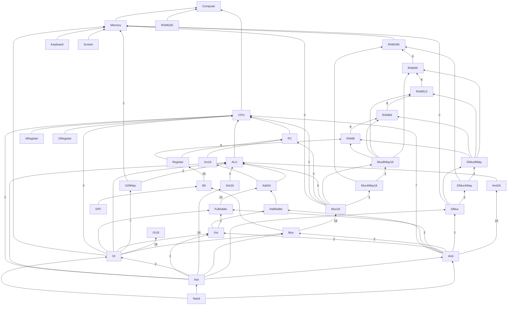
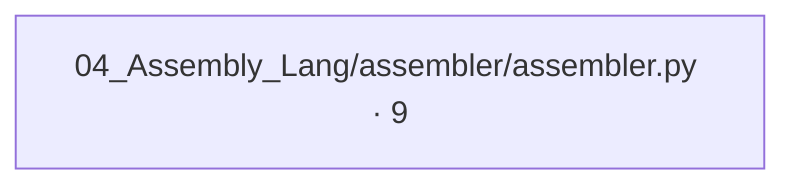
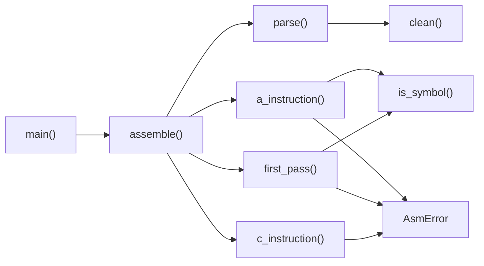

# Codemap: nand2tetris

← [README](README.md)

> Generated from commit `1823832` by `scripts/codemap.py`. Regenerate it from the workspace root with `python3 scripts/codemap.py nand2tetris`; don't edit it by hand.

## Chips

Which chip is built from which. A number on an arrow is how many of that part it uses; built-in chips: `ARegister`, `DFF`, `DRegister`, `Keyboard`, `Nand`, `ROM32K`, `Screen`.

| Chip | File | Parts |
|---|---|---|
| `And` | `01_Boolean_Logic/And.hdl` | Nand, Not |
| `And16` | `01_Boolean_Logic/And16.hdl` | And×16 |
| `DMux` | `01_Boolean_Logic/DMux.hdl` | And×2, Not |
| `DMux4Way` | `01_Boolean_Logic/DMux4Way.hdl` | DMux×3 |
| `DMux8Way` | `01_Boolean_Logic/DMux8Way.hdl` | DMux, DMux4Way×2 |
| `Mux` | `01_Boolean_Logic/Mux.hdl` | And×2, Not, Or |
| `Mux16` | `01_Boolean_Logic/Mux16.hdl` | Mux×16 |
| `Mux4Way16` | `01_Boolean_Logic/Mux4Way16.hdl` | Mux16×3 |
| `Mux8Way16` | `01_Boolean_Logic/Mux8Way16.hdl` | Mux16, Mux4Way16×2 |
| `Not` | `01_Boolean_Logic/Not.hdl` | Nand |
| `Not16` | `01_Boolean_Logic/Not16.hdl` | Not×16 |
| `Or` | `01_Boolean_Logic/Or.hdl` | Nand, Not×2 |
| `Or16` | `01_Boolean_Logic/Or16.hdl` | Or×16 |
| `Or8Way` | `01_Boolean_Logic/Or8Way.hdl` | Or×7 |
| `Xor` | `01_Boolean_Logic/Xor.hdl` | And×2, Not×2, Or |
| `ALU` | `02_Boolean_Arithmetic/ALU.hdl` | Add16, And16, Mux16×6, Not, Not16×3, Or, Or8Way×2 |
| `Add16` | `02_Boolean_Arithmetic/Add16.hdl` | FullAdder×15, HalfAdder |
| `FullAdder` | `02_Boolean_Arithmetic/FullAdder.hdl` | And×2, Or, Xor×2 |
| `HalfAdder` | `02_Boolean_Arithmetic/HalfAdder.hdl` | And, Xor |
| `Inc16` | `02_Boolean_Arithmetic/Inc16.hdl` | Add16 |
| `Bit` | `03_Sequential_Logic/Bit.hdl` | DFF, Mux |
| `PC` | `03_Sequential_Logic/PC.hdl` | Inc16, Mux16×3, Register |
| `RAM16K` | `03_Sequential_Logic/RAM16K.hdl` | DMux4Way, Mux4Way16, RAM4K×4 |
| `RAM4K` | `03_Sequential_Logic/RAM4K.hdl` | DMux8Way, Mux8Way16, RAM512×8 |
| `RAM512` | `03_Sequential_Logic/RAM512.hdl` | DMux8Way, Mux8Way16, RAM64×8 |
| `RAM64` | `03_Sequential_Logic/RAM64.hdl` | DMux8Way, Mux8Way16, RAM8×8 |
| `RAM8` | `03_Sequential_Logic/RAM8.hdl` | DMux8Way, Mux8Way16, Register×8 |
| `Register` | `03_Sequential_Logic/Register.hdl` | Bit×16 |
| `CPU` | `05_Computer/CPU.hdl` | ALU, ARegister, And×7, DRegister, Mux16×2, Not×2, Or×4, PC |
| `Computer` | `05_Computer/Computer.hdl` | CPU, Memory, ROM32K |
| `Memory` | `05_Computer/Memory.hdl` | DMux×2, Keyboard, Mux16×3, Or, Or8Way×2, RAM16K, Screen |

## Files

Each box is a source file and its function count; an arrow means calls into that file.

## Hubs

The most connected functions: where a change reaches furthest.

| Function | Where | Called by | Calls |
|---|---|---|---|
| `assemble()` | `04_Assembly_Lang/assembler/assembler.py:132` | 1 | 4 |
| `AsmError` | `04_Assembly_Lang/assembler/assembler.py:57` | 3 | 0 |
| `a_instruction()` | `04_Assembly_Lang/assembler/assembler.py:99` | 1 | 2 |
| `first_pass()` | `04_Assembly_Lang/assembler/assembler.py:82` | 1 | 2 |
| `c_instruction()` | `04_Assembly_Lang/assembler/assembler.py:115` | 1 | 1 |
| `is_symbol()` | `04_Assembly_Lang/assembler/assembler.py:74` | 2 | 0 |
| `parse()` | `04_Assembly_Lang/assembler/assembler.py:66` | 1 | 1 |
| `clean()` | `04_Assembly_Lang/assembler/assembler.py:61` | 1 | 0 |
| `main()` | `04_Assembly_Lang/assembler/assembler.py:152` | 0 | 1 |

## Functions

### `04_Assembly_Lang/assembler/assembler.py`

- `AsmError` L57
- `clean()` L61
- `parse()` L66 → `clean()`
- `is_symbol()` L74
- `first_pass()` L82 → `is_symbol()`, `AsmError`
- `a_instruction()` L99 → `AsmError`, `is_symbol()`
- `c_instruction()` L115 → `AsmError`
- `assemble()` L132 → `parse()`, `first_pass()`, `a_instruction()`, `c_instruction()`
- `main()` L152 → `assemble()`
