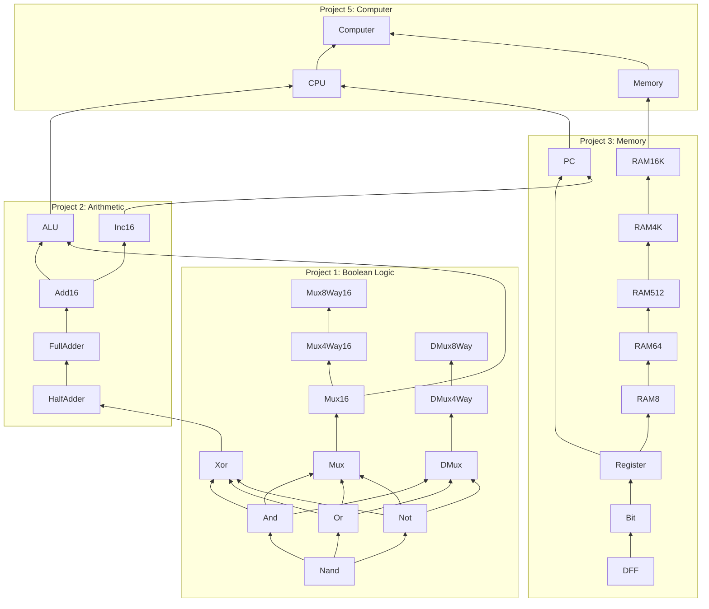
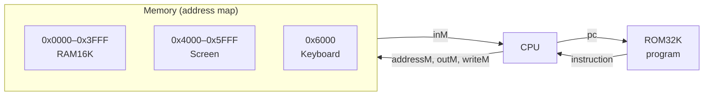
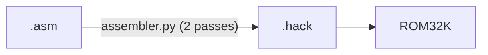

# NAND2Tetris: A 16-bit Computer from One Gate

> The Hack computer built from a single NAND gate up to a working CPU, plus its machine language.


## Overview

Every chip here derives from `Nand` (plus the course's built-in `DFF`). The point is to have no black boxes left under the kernel and embedded work that comes next.

## The Silicon Stack



## Architecture



**ALU:** six control bits (`zx nx zy ny f no`) select 18 functions; `ng` is `out[15]`, and `zr` is two `Or8Way`s on the halves. **CPU:** `A`/`D` registers and the ALU, with jumps decoded from `zr`/`ng` and gated on `instruction[15]`. **Memory:** addresses past `0x6000` read 0.

## Software



| File | What it does |
|---|---|
| `flip.asm` | Swaps `RAM[0]` and `RAM[1]` |
| `sum_1_to_n.asm` | `RAM[1] = 1 + 2 + … + RAM[0]` |
| `pointer_manipulation.asm` | `arr[i] = -1` for `i < 10`, `arr = 100` |
| `assembler/assembler.py` | Hack assembler: labels, variables from `RAM[16]`, every `comp`/`dest`/`jump` |

> **About the assembler:** the original was written for Project 6 and then lost (only an empty file survived). The current `assembler.py` is a **stand-in replacement written by an AI assistant**, so the toolchain works end to end. It is not the original work.

```bash
python 04_Assembly_Lang/assembler/assembler.py 04_Assembly_Lang/sum_1_to_n.asm   # → sum_1_to_n.hack
```

## Simulation

Load any `.hdl` into the [Nand2Tetris Web IDE](https://nand2tetris.github.io/web-ide/chip/) with its course `.tst` script.

## Progress

- [x] **Project 1:** Boolean Logic
- [x] **Project 2:** Boolean Arithmetic
- [x] **Project 3:** Sequential Logic
- [x] **Project 4:** Machine Language
- [x] **Project 5:** Computer Architecture (CPU, Memory, Computer). *Part 1 hardware complete.*
- [x] **Project 6:** The Assembler *(original lost; AI-written replacement in place)*
- [ ] **Projects 7–8:** VM Translator
- [ ] **Project 9:** High-Level Language (Jack)
- [ ] **Projects 10–11:** Compiler
- [ ] **Project 12:** Operating System

---
*powered by logic, coffee, and many sleepless nights*
