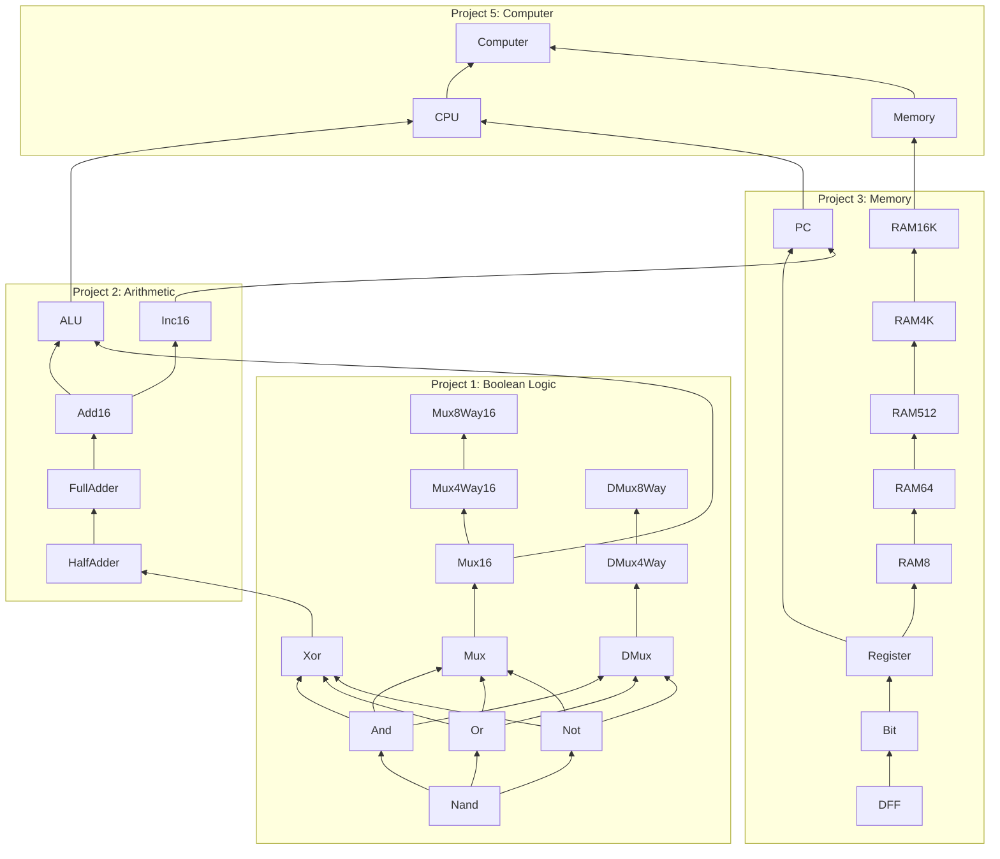
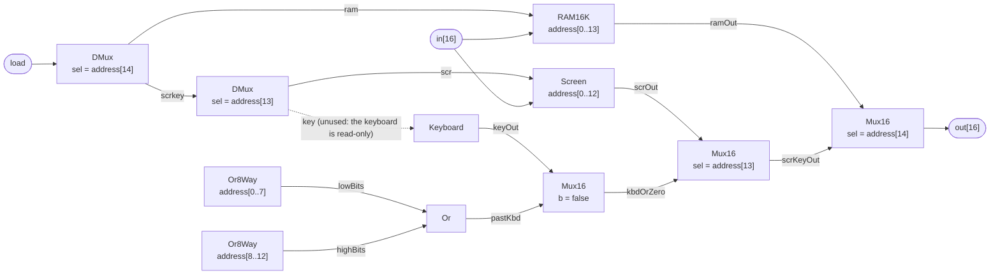
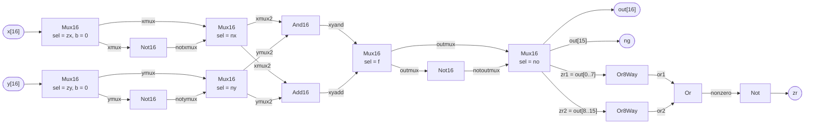
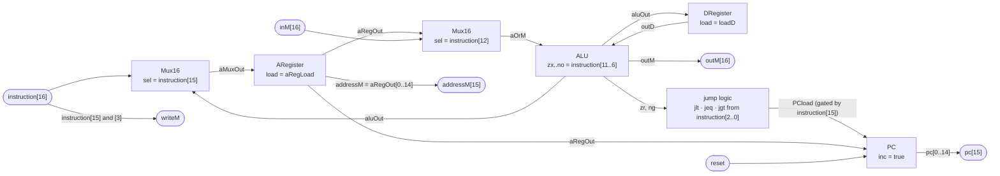
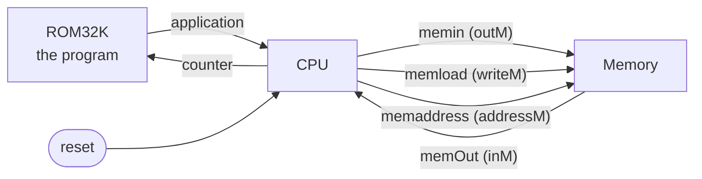
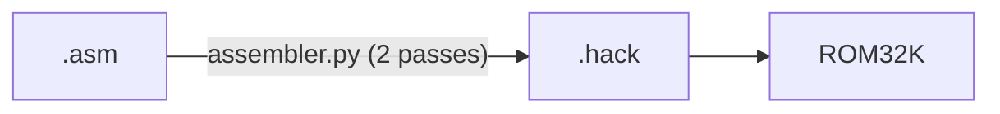

# NAND2Tetris: A 16-bit Computer from One Gate

> The Hack computer built from a single NAND gate up to a working CPU, plus its machine language.


## Overview

Every chip here derives from `Nand` (plus the course's built-in `DFF`). The point is to have no black boxes left under the kernel and embedded work that comes next.

## The Silicon Stack



## The Hardware, Wire by Wire

Every diagram below is drawn from its `.hdl` file: boxes are parts, edge labels are the actual wire names.

### Memory (`05_Computer/Memory.hdl`)



| Address | Goes to |
|---|---|
| `0x0000–0x3FFF` | RAM16K (`address[14] = 0`) |
| `0x4000–0x5FFF` | Screen (`address[14..13] = 10`) |
| `0x6000` | Keyboard (`address[14..13] = 11`, low 13 bits all 0) |
| above `0x6000` | reads 0 (`pastKbd` zeroes the keyboard path) |

### ALU (`02_Boolean_Arithmetic/ALU.hdl`)



Six control bits pick 18 functions: `zx nx` prepare `x`, `zy ny` prepare `y`, `f` chooses add or and, and `no` negates the result.

### CPU (`05_Computer/CPU.hdl`): where the ALU lives



| Control wire | Built from | Means |
|---|---|---|
| `aRegLoad` | `not i[15]` or (`i[15]` and `i[5]`) | A-instruction, or a C-instruction with `d1` |
| `loadD` | `i[15]` and `i[4]` | C-instruction with `d2` |
| `writeM` | `i[15]` and `i[3]` | C-instruction with `d3` |
| `PCload` | `i[15]` and (`jlt` or `jeq` or `jgt`) | the jump condition holds; `pos = not (zr or ng)` |

### The Computer (`05_Computer/Computer.hdl`): how they connect



One cycle: `ROM32K[counter]` is the instruction, the CPU computes it against `memOut`, writes `memin` to `memaddress` when `memload` is set, and the PC picks the next `counter`.

## Software



| File | What it does |
|---|---|
| `flip.asm` | Swaps `RAM[0]` and `RAM[1]` |
| `sum_1_to_n.asm` | `RAM[1] = 1 + 2 + … + RAM[0]` |
| `pointer_manipulation.asm` | `arr[i] = -1` for `i < 10`, `arr = 100` |
| `assembler/assembler.py` | Hack assembler: labels, variables from `RAM[16]`, every `comp`/`dest`/`jump` |

> **About the assembler:** the original was written for Project 6 and then lost (only an empty file survived). The current `assembler.py` is a **stand-in replacement written by an AI assistant**, so the toolchain works end to end. It is not the original work.

```bash
python 04_Assembly_Lang/assembler/assembler.py 04_Assembly_Lang/sum_1_to_n.asm   # → sum_1_to_n.hack
```

## Simulation

Load any `.hdl` into the [Nand2Tetris Web IDE](https://nand2tetris.github.io/web-ide/chip/) with its course `.tst` script.

## Progress

- [x] **Project 1:** Boolean Logic
- [x] **Project 2:** Boolean Arithmetic
- [x] **Project 3:** Sequential Logic
- [x] **Project 4:** Machine Language
- [x] **Project 5:** Computer Architecture (CPU, Memory, Computer). *Part 1 hardware complete.*
- [x] **Project 6:** The Assembler *(original lost; AI-written replacement in place)*
- [ ] **Projects 7–8:** VM Translator
- [ ] **Project 9:** High-Level Language (Jack)
- [ ] **Projects 10–11:** Compiler
- [ ] **Project 12:** Operating System

---
*powered by logic, coffee, and many sleepless nights*
